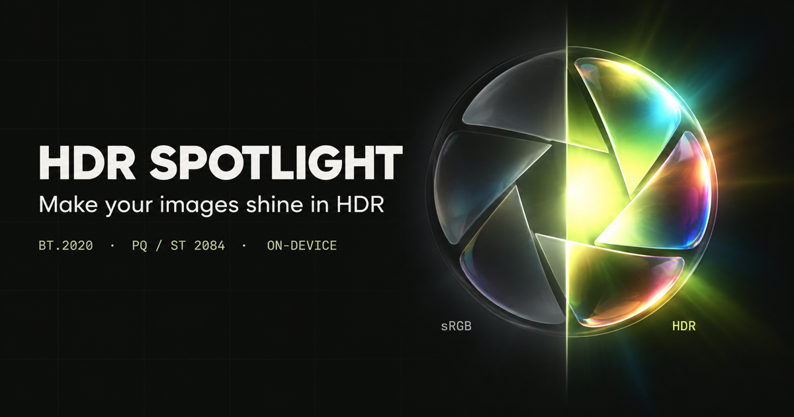

# HDR Spotlight



A local HDR image workbench built with Angular 22 and Tailwind CSS 4. Upload, drop or paste PNG, JPEG, WebP or SVG artwork, adjust exposure and export a PQ-encoded BT.2020 image. No files are uploaded to a server.

Website: [hdrspotlight.com](https://hdrspotlight.com/)

## Development

```sh
pnpm install --frozen-lockfile
pnpm start
```

Open http://localhost:4200. Run the full quality check:

```sh
pnpm check
```

This checks formatting, runs ESLint and unit tests, and builds the production application. Use `pnpm test:ci` to run the tests separately.

## Image converter

The `/convert` route exports PNG, JPEG, WebP, BMP and ICO locally. JPEG and WebP
have adjustable quality; other outputs are lossless or uncompressed. Optional resizing
supports linked dimensions. ICO exports one size (16–256 px) with transparent padding.
JPEG and BMP composite transparency onto a selectable background.

Inputs include PNG, JPEG, WebP, GIF, BMP, ICO, AVIF and SVG, subject to browser decoding
support. Limits are 32 MB, 16 megapixels and 16,384 px per side. Output is static SDR;
animation, source metadata and HDR profiles are not retained. SVG is rasterized.

Native canvas encoding is used when available. WebP falls back to the lazily loaded
`@jsquash/webp` encoder; its WASM assets are served locally from `/assets/codecs/`
and cached on demand by the service worker. No third-party image service is used.

## SDR LUT studio

The `/lut` route applies creative 3D `.cube` LUTs to sRGB SDR images locally. Try the
built-in looks on an AI-generated still life before uploading your own PNG, JPEG or
WebP image. A before/after split and intensity control update a reduced-size preview;
PNG, JPEG and WebP exports retain the source dimensions. PNG and WebP retain alpha;
JPEG composites onto the selected background after the LUT transform.

Alongside the generated Warm daylight, Cool shade and Soft matte looks, the studio
includes five bundled creative tables: Silver mist, Amber glow, Copper trail,
Alpine film and Desert bloom. Each `.cube` file loads only when selected and is
cached after successful parsing. The service worker caches these assets on demand.
Selecting another look cancels the pending request; a failed download keeps the
previous look available and can be retried.

The five bundled Standard/Rec.709 looks use 95% of their original output saturation
and are applied directly to encoded sRGB channels as creative looks. The workspace does
not infer a source transfer function or reproduce a color-managed video-editor
pipeline. Display names are supplied by the preset catalogue rather than file titles.

Hollywood teal & orange is an original 33³ sRGB look with teal shadows, warm color
and gentle film contrast, with output saturation increased to 110% of the base recipe.
Its smooth color masks soften the cyan shift for orange
hues and preserve black and white endpoints; this is a color transform rather than
face or skin detection. The selected look offers a **Download LUT .cube** link for
use in other editors. Regenerate the bundled table from its original recipe with
`pnpm generate:lut` (Node 24). The recipe lives in
`src/app/features/lut/engine/teal-orange.ts` and is independent of third-party tables.
Saturation scales the RGB distance from weighted gray while preserving that gray
level. A shared gamut limit prevents the 110% adjustment from clipping a channel.
These adjustments are baked into the LUT tables, so preview, image export and LUT
download use the same values; the Intensity control remains independent.

The parser accepts 2–65 points per channel, `TITLE`, `DOMAIN_MIN`, `DOMAIN_MAX` and
comments, with a 16 MiB LUT file limit. It validates table length, finite values and
input domains. Processing uses tetrahedral interpolation in a cancellable worker,
with a yielding fallback when workers are unavailable. The same transform is used
for preview and export. Image limits match the other workspaces: 32 MiB, 16 megapixels
and 16,384 pixels per side.

This first version expects LUTs designed for encoded sRGB input and output. It does
not infer a LUT's color space or convert camera Log/HDR LUTs. 1D LUTs, combined
shaper/3D tables and alternate input-range directives are rejected. Input images are
normalized through an sRGB canvas; source metadata is not retained. WebP uses the
shared local WASM fallback if native canvas encoding is unavailable.

The demo asset is `public/images/lut-demo.jpg`; its generation prompt and provenance
are documented in [Demo image](docs/lut-demo.md).

## PWA updates

The global update banner appears after Angular's service worker has downloaded a new
version (`VERSION_READY`). **Update now** reloads the current page; **Later** hides the
notification for that version for the current app session. A newer version can show it
again. Reloading clears the in-memory image and settings, so the banner asks users to
download their results first. The app never reloads automatically.

Update checks run after the app becomes stable, every 15 minutes while visible, when
returning to the tab (throttled to once a minute), and when the network reconnects.
Offline failures are retried on subsequent checks. An unrecoverable service-worker
state shows a recovery message with the same explicit reload action. This behavior is
disabled during SSR and when service workers are unavailable or disabled.

The banner can only appear in clients that have already loaded a release containing
this feature. It does not replace deploying the latest build or correcting server/CDN
cache headers.

## Docker

Build and run the production SSR image locally:

```sh
docker build -t hdr-spotlight .
docker run --rm -p 4200:4200 hdr-spotlight
```

## Structure

The application uses feature-based boundaries:

- `src/app/core/`: application shell, SEO and theme state.
- `src/app/features/hdr/`: HDR pages, components, state, services and pixel engine.
- `src/app/features/converter/`: conversion page, state, services and settings.
- `src/app/features/legal/`: privacy and terms pages.
- `src/app/shared/`: reusable UI and image models, geometry, limits and codecs.
- `src/styles/`: global styles and fonts.

Tests live next to their implementation. ESLint prevents dependencies between features
and dependencies from shared code back into application or feature code.
See [Architecture](docs/architecture.md) for the folder tree, ownership rules and validation.

## Image behavior

- Pipeline: sRGB canvas decode/compositing → linear sRGB → selected highlight boost → linear BT.2020 → absolute luminance anchored at 203 nits → 8-bit ST 2084 PQ with ordered dithering.
- JPEG includes an ICC v4.4 profile with CICP `9 / 16 / 0 / 1`. It uses the browser's highest-quality JPEG encoding; exact chroma subsampling is browser-dependent.
- PNG carries a `cICP` chunk. Enable **Preserve transparency** to retain the alpha channel of the rasterized source and transparent padding; the preview, primary download and statistics then refer to PNG. JPEG always composites the source onto the selected background before HDR encoding. With the switch off, both outputs are opaque. Transparent-image coverage is weighted by opacity; fully invisible pixels do not affect peak luminance.
- Choose a square preset, original dimensions, or a custom width and height (up to 16 megapixels and 16,384 pixels per side). **Keep aspect ratio** is on by default and fits the artwork inside the canvas with padding. Turn it off to stretch the image to the exact canvas dimensions. The same sizing applies to PNG, JPEG and the JPEG quality preview.
- Inputs are limited to 32 MB, 16 megapixels and 16,384 pixels per side. Output presets run through 3840 × 3840.
- Input color is normalized through an sRGB canvas. This is not a wide-gamut preservation workflow or a gain-map encoder.
- HDR appearance depends on the display, browser, color management and power settings. The preview uses the actual exported file, without simulated CSS brightness. The Light/Dark preview backdrop does not change output pixels.

## Engine details

- Pixel encoding uses an approximately 64 KiB PQ lookup table with denser samples near black and interpolation between samples. The darkest values use the exact formula. The exact PQ functions remain available for reference calculations. In `whites` mode, all 256 possible mask weights are calculated once per transform.
- Highlight masks use source sRGB values; exposure is applied in linear light. Zero feather produces a hard threshold, including pixels exactly on the threshold. The 4 × 4 Bayer dither offsets are centered on zero and shared across RGB channels.
- Before modifying pixels, the engine rejects empty or invalid dimensions, mismatched RGBA buffers, non-finite exposure, threshold/feather outside `0..1`, unknown modes and invalid boolean options. Exposure must also produce a finite luminance.
- PNG metadata insertion replaces existing `cICP` chunks, so repeated calls do not add duplicates. JPEG replaces APP1/APP2 metadata with the supplied ICC profile and preserves the scan bytes. Container checks validate signatures, segment/chunk boundaries and required end markers; they do not decode compressed pixels or verify CRCs of retained PNG chunks.

Unit tests cover PQ accuracy and monotonicity, hard thresholds, invalid inputs, dither averages, coverage/clipping, ICC fields, JPEG segment splitting, repeated metadata replacement, truncated containers, PNG CRC generation, asynchronous store races, settings propagation/reset, and browser-listener cleanup. PQ lookup tests compare linear and logarithmic samples against the exact formula with an error limit of 0.005 of an 8-bit code value before rounding; values near rounding boundaries can still differ by one output code.

Manual browser checks have also exercised Canvas PNG/JPEG export and decoding, alpha preservation and repeated metadata replacement. Pixel-transform benchmarks exclude Canvas work and file compression; their speedup is not an end-to-end export guarantee.

## License

The project source code is available under the [MIT License](LICENSE). Montserrat and JetBrains Mono are distributed under the SIL Open Font License 1.1; their license texts are included alongside the font files.
